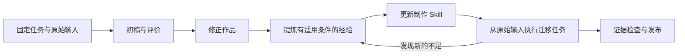

# Animation Skills

面向 Meshy 与 Blender 的角色动画 Skill 开发工程。通过实际制作任务、作品评价和修正经验，提高模型的动画制作能力、品味与正确率。

Skill 负责制作知识、审美判断、示范资产和具体操作。任务调度、重试、回滚及自主修复属于外部 harness。

## 当前版本

工程初始版本为预览版。制作型 Skill 是待评测的草案；case 定义不代表作品已经制作或通过评价。只有实际产物、评价记录和迁移任务支持的经验，才能标为经过验证。

| 制作能力 | Skill |
| --- | --- |
| 步态、转停、坐站 | [character-body-mechanics](.trae/skills/character-body-mechanics/SKILL.md) |
| 搬运、持握、工具冲击 | [character-prop-interaction](.trae/skills/character-prop-interaction/SKILL.md) |
| 注意力、反应、情绪动作 | [character-acting](.trae/skills/character-acting/SKILL.md) |

已定义 [6 个开发案例与 3 个迁移案例](cases/README.md)，固定使用已有 Meshy 角色。Skill 分工和 20 条待实测路由样例见 [路由说明](docs/routing.md)。

## 工程结构

```text
.trae/skills/       可独立打包的制作型 Skill
cases/             固定制作任务与逐次运行记录
lessons/           从作品修正中提炼的经验
templates/         运行记录与经验记录模板
docs/              制作、评测和发布说明
tools/             检查、输入准备和打包工具
tests/             工程工具的回归检查
viewer/            Three.js 案例查看器
.artifacts/        本地模型、工程和视频，不提交 Git
dist/              发布包，不提交 Git
```

Python 3.9 及以上版本即可运行工程命令，不需要第三方 Python 包。实际动画制作另外需要 Blender；使用 Meshy 时由执行环境提供已配置的 MCP。

## 常用命令

在仓库根目录执行：

```bash
python3 tools/project.py check
python3 -m unittest discover -s tests
python3 tools/project.py package
```

`check` 检查工程结构和记录一致性，不评价动画画面。`package` 在 `dist/<version>/` 生成标明成熟度的预览包、发布清单和 SHA-256 校验文件；已有版本目录不会覆盖。

准备一个任务的独立输入目录：

```bash
python3 tools/project.py prepare walk-turn-stop .artifacts/work/walk-turn-stop
```

准备目录只包含任务要求和固定输入，不包含修正版、评价记录或经验答案。首次使用前需按资产清单准备文件；参见 [工程约定](docs/engineering.md)。

## Three.js 查看器

首次使用需安装 Node.js 与 npm。在仓库根目录执行：

```bash
npm ci
make viewer
```

打开 `http://127.0.0.1:8765`。可用 `make viewer PORT=8766` 更换端口，用 `Ctrl+C` 停止服务。查看器依赖锁定的 Three.js 版本；安装后无需外部 CDN。

- 切换 9 个案例，查看任务尺寸对应的静态布景、制作要求与评价标准。
- 播放 GLB 动画，支持暂停、逐帧、进度拖动、倍速、循环、正侧视图和骨架。
- 开启双视图，按同一秒数比较两个片段；较短片段停在末帧。
- 通过“载入 GLB”查看本地文件；文件只在浏览器中读取，不上传或写入运行记录。

`sit-stand` 已有 7 秒坐下、坐住和起立动作，`low-seat-transfer` 已有 6 秒低凳起身并迈一步动作。查看器默认选用已登记的修正版或初稿；这些作品仍待独立品味评价。制作脚本、产物位置与验证方式见 [两段坐站动作](docs/seated-motion.md)。

其余案例仍显示固定角色的源动作：Idle 2 秒、Walk 1 秒、Chop 0.8 秒。源动作与静态布景不表示案例已完成。角色输入按 case 身高居中显示；已制作的导出物保留原始单位和根位移。

后续在运行记录的 `initial.artifacts` 或 `corrected.artifacts` 中登记 `role=export` 的 GLB、路径及 SHA-256，刷新页面即可从素材列表选择。缺失或哈希不一致的文件不会加载。评价标签来自运行记录，临时导入文件始终显示“未登记评价”。

本地服务只提供查看器、Three.js 和清单内可核对的 GLB，不提供仓库目录浏览。查看器不进入 Skill ZIP，Python 工程命令也不依赖 npm。

## 制作与完善



1. 选择一个具体制作任务，固定输入、镜头、预算和评价标准。
2. 使用指定版本的 Skill 制作初稿，保留可编辑工程与原速视频。
3. 记录可定位的不足，修正作品，保存有效选择及失败尝试。
4. 根据确认后的作品提炼有适用条件的经验，更新对应 Skill。
5. 从原始输入重新制作，并在不同体型、道具或表演要求下检查经验能否迁移。

用 `python3 tools/project.py new-run <case-id> <run-id>` 建立带指纹的待填写记录。完整记录要求见 [工程约定](docs/engineering.md)，打包、发布与安装见 [发布说明](docs/release.md)。

制作知识随 Skill 发布；评测输入、完整运行历史和未确认经验留在研发工程。当前已开始两项动画制作记录，尚未完成独立品味评价、Skill 迁移能力验证或远端 Release。
