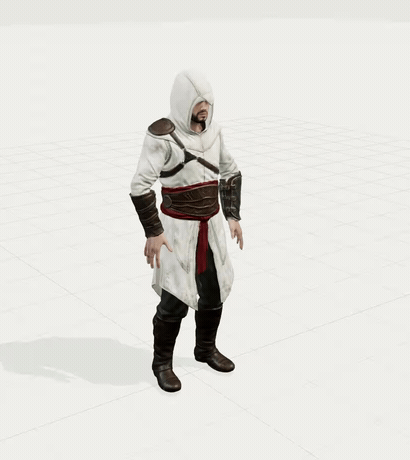
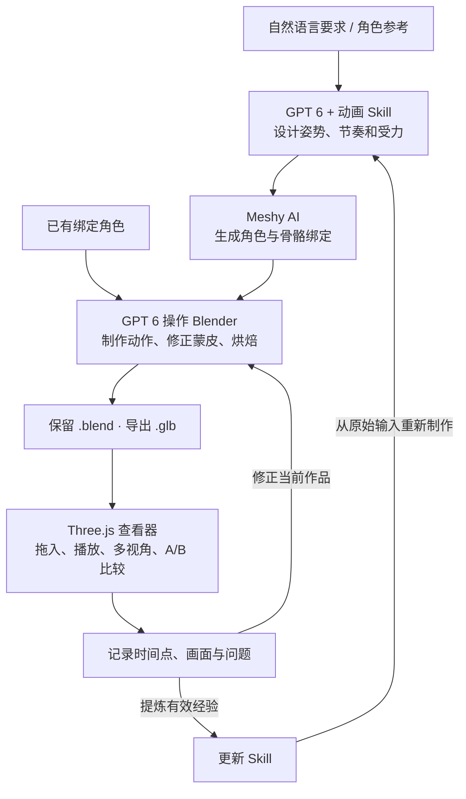

# Animation Skills

用自然语言设计角色动作，把制作经验沉淀为可复用的 Agent Skill。

**GPT 6 设计与制作 · Meshy AI 生成角色 · Blender 编辑与导出 · Three.js 预览与比较**

<p align="center">
  
</p>
<p align="center"><em>兜帽刺客 · 5 秒蹲起循环 · Three.js 查看器实录</em></p>

上图从“生成一个刺客信条风格的角色，并实现蹲起动画”开始：Agent 设计外观和动作节奏，通过 Meshy AI 生成并绑定角色，在 Blender 中制作蹲起，最后将 GLB 载入查看器检查。角色为新生成资产，衣摆使用骨骼蒙皮，深蹲时折叠仍偏硬。制作环境与检查范围见 [示例说明](docs/assassin-crouch.md)。

本工程包含三个动画 Skill、九个制作案例和一个本地查看器。您可以直接描述新动作，也可以用固定案例检查 Skill 修改前后的表现。

[快速开始](#快速开始) · [使用 Skill](#使用-skill) · [制作工作流](#制作工作流) · [迭代 Skill](#迭代-skill) · [开发与打包](#开发与打包)

## 快速开始

预览需要 Python 3.9+、Node.js、npm 和支持 WebGL 2 的浏览器。在终端执行：

```bash
git clone https://github.com/creativedswork/animation-skills.git
cd animation-skills
npm ci
make viewer
```

打开 [本地查看器](http://127.0.0.1:8765)，将一个 `.glb` 文件拖入视图 A，选择动作后点击播放。也可以使用“载入 GLB”按钮。

开启“双视图”，分别将初稿和修正版拖入 A、B，即可按同一时间比较。支持暂停、逐帧、进度拖动、0.25× 慢放、循环、正侧视图和骨架显示。每个视图一次接收一个文件，拖错格式后可直接重新拖入。

克隆仓库会得到案例定义、制作记录和上方 GIF。历史 GLB、Blender 工程和视频保留在制作机器的 `.artifacts/`，不随 Git 分发；首次打开可能显示“素材缺失”，直接拖入您自己的 GLB 即可使用。

用 `make viewer PORT=8766` 更换端口，`Ctrl+C` 停止服务。没有 `make` 时使用 `python3 tools/viewer.py --port 8765`。Three.js 锁定在 npm 依赖中，安装后查看器无需外部 CDN。

## 使用 Skill

Skill 是 Agent 读取的制作指导，内容包括动作设计、受力判断、Blender 操作和检查方法。在支持 Skill 的 Agent 中使用它，并为 Agent 配置 Meshy、Blender 等工具。

| 您要制作的动作 | 选择的 Skill | 重点 |
| --- | --- | --- |
| 行走、转向、停步、坐下起立、蹲起 | [character-body-mechanics](.trae/skills/character-body-mechanics/SKILL.md) | 重心、支撑、步态与平衡 |
| 搬箱、抱物转身、挥斧、操作工具 | [character-prop-interaction](.trae/skills/character-prop-interaction/SKILL.md) | 握持、负载转移与接触 |
| 警觉、犹豫、疲惫、放松 | [character-acting](.trae/skills/character-acting/SKILL.md) | 视线、节奏与情绪表达 |

组合动作可以同时使用多个 Skill，例如“疲惫地走几步，再放下重箱”。具体分工见 [Skill 路由说明](docs/routing.md)。

### 1. 让 Agent 读取 Skill

使用 TRAE 时，直接打开本仓库，在新会话中确认 `.trae/skills/` 下的三个 Skill 已被发现。其他支持 Skill 的 Agent 可将对应目录放入其约定的 Skill 位置，或显式要求它读取 `SKILL.md` 及相关参考文件。

用于其他项目时，将需要的完整 Skill 目录复制到该项目的 `.trae/skills/`，保留 `references/` 等子目录。先检查同名目录，避免覆盖本地修改。用户级安装和独立 ZIP 见 [安装说明](docs/release.md#安装单个-skill)。

### 2. 配置制作工具

| 工具 | 在这条工作流中的职责 | 何时需要 |
| --- | --- | --- |
| GPT 6 / Agent | 解析要求、设计关键姿势与节奏、调用工具、诊断并修正 | 使用 Skill 制作时 |
| Meshy AI | 生成外观参考、角色模型及骨骼绑定 | 需要新角色或新绑定时 |
| Blender | 检查骨架与蒙皮、编辑动作、烘焙关键帧、导出 GLB | 制作与修正动画时 |
| Three.js 查看器 | 播放导出物、切换视角、慢放和 A/B 比较 | 预览与评价时 |

本仓库提供动画制作 Skill 和查看器。Agent 运行环境负责接入模型、配置 MCP 或本地工具、提供服务凭证；启动查看器不需要 GPT 6、Meshy 账号或 Blender。已有绑定角色可以直接进入动作制作。

### 3. 描述动作和交付要求

在 Agent 对话中发送，例如：

```text
使用 character-body-mechanics。

生成一个刺客信条风格的白袍兜帽角色，制作 5 秒、30 fps 的蹲起循环：
站立准备 → 下蹲 → 低姿势停留 → 起身 → 恢复站立。
要求脚底稳定，膝盖朝脚尖方向弯曲，躯干和手臂参与平衡。

使用 Meshy AI 生成并绑定角色，在 Blender 中制作动作。
将初稿与修正版分别保存在 .artifacts/ 下，交付可编辑 .blend、
包含骨架和动画的 .glb，以及正面、侧面原速预览。
先检查动作画面，再检查接触、循环接缝及导出回读；说明尚未解决的问题。
```

如果已有模型，将生成角色的要求替换为明确的本地文件路径。动作描述尽量包含意图、起止姿势、时长、风格和需要接触的物体。

新动作无需先建立 case。Agent 交付 GLB 后，将它拖进查看器即可预览；希望长期比较和积累证据时，再按下文登记制作任务。

## 制作工作流



GPT 6 负责设计和执行制作步骤，Meshy AI 提供角色资产，Blender 保存可编辑动作。查看器以 GLB 连接制作和评价：您既能检查新导出的文件，也能将初稿与修正版并排播放。

查看器本身不生成动画，也不自动将反馈发回 Agent。当前反馈方式是把时间点、视角、截图或录屏交给 Agent，再由它读取工程并修改。例如：

```text
使用 character-body-mechanics 检查刚才的蹲起。
侧面 2.1 秒处衣摆折叠生硬，起身时膝盖伸直过早。
读取原 .blend，定位蒙皮和动作时序问题，保留初稿并另存修正版。
重新导出 GLB，我会在 A/B 双视图中比较。
```

拖入的文件仅在浏览器中读取，不上传、不写入运行记录。临时模型标为“未登记评价”；刷新页面或切换案例后需重新载入。界面上的案例要求仍属于当前选中的案例，不会因拖入文件而自动改写。

## 迭代 Skill

一次作品修好后，还需要检查修改后的 Skill 能否指导下一次制作。推荐按以下顺序保留证据：

1. **固定任务与输入。** 选择开发案例，记录模型、工具版本和制作预算。
2. **使用当前 Skill 制作初稿。** 保存 `.blend`、GLB 和原速录像，保留本轮 Skill 的指纹。
3. **在查看器评价。** 先原速看动作意图，再用侧视、慢放和骨架检查脚滑、穿插、握持和节奏。记录具体时间点，分别评价技术正确性与表现力。
4. **修正并比较。** 初稿放 A，修正版放 B；记录改了什么、为什么有效、还有哪些局限。
5. **将经验写回 Skill。** 在 `lessons/` 留下来源证据；通用选择写入 `SKILL.md`，情境分支写入 `references/`，可重复操作写入 `scripts/`。
6. **从原始输入重跑。** 用更新后的 Skill 制作新初稿，再执行不同动作或情境的迁移案例，检查方法能否复用。

对于 Skill 效果对比，保持输入、模型、工具和预算一致，分别执行不带 Skill 的基线和带 Skill 的候选。迁移制作时只提供任务、原始素材及指定 Skill，不提供修正版工程或评价答案。

### 用固定案例记录一轮制作

工程已有 [6 个开发案例和 3 个公开迁移案例](cases/README.md)，覆盖行走转停、坐站、低凳起身、搬重箱、斧击、抱箱转身、警觉、疲惫和放松。

先按 [资产清单](assets.json) 恢复固定输入。`check --artifacts` 还会核对所有已登记的历史产物，因此需要完整本地素材。在仓库根目录执行：

```bash
python3 tools/project.py check --artifacts
python3 tools/project.py prepare walk-turn-stop .artifacts/work/walk-turn-stop
python3 tools/project.py new-run walk-turn-stop candidate-001
```

`prepare` 生成只含任务与固定输入的制作目录；`new-run` 创建带内容指纹的待填写记录。这两个命令不调用模型或启动 Blender。将准备好的输入交给制作 Agent，完成后填写 `cases/walk-turn-stop/runs/candidate-001.json`。重跑时使用新的运行 ID 和输出目录。

在 `initial.artifacts` 或 `corrected.artifacts` 中登记 `role=export`、GLB 相对路径和 SHA-256 后，刷新查看器即可在素材列表中选择该作品。临时拖入则无需登记。记录格式、评价尺度和经验晋升条件见 [工程约定](docs/engineering.md)。

九个案例已有制作记录，原制作环境保留了动画产物；当前三个 Skill 仍为 `draft`，版本为 [`0.1.0-dev.2`](catalog.json)。作品尚待独立表现力评价和完整迁移验证，GIF 展示不代表 Skill 评测通过。

## 工程结构

```text
.trae/skills/       三个可独立安装的动画 Skill
viewer/            Three.js 本地查看器
cases/             固定任务、评价标准与逐次运行记录
lessons/           作品修正中提炼的经验
templates/         运行记录和经验记录模板
tools/             输入准备、检查、打包与案例制作脚本
tests/             工程检查和查看器回归验证
docs/              工作流说明与演示 GIF
.artifacts/        本地模型、Blender 工程和视频，不提交 Git
dist/              生成的 Skill 安装包，不提交 Git
```

Skill 可独立使用；查看器也可单独预览 GLB。打包工具仅收集 `.trae/skills/` 中的允许资源，查看器、案例答案和本地模型不进入 Skill ZIP。

## 开发与打包

工程工具使用 Python 标准库。在仓库根目录执行：

```bash
python3 tools/project.py check
python3 -m unittest discover -s tests
python3 tools/project.py package
```

`check` 检查结构和记录一致性；`package` 在 `dist/<version>/` 生成三个 Skill ZIP、清单和 SHA-256 文件，拒绝覆盖已有版本目录。代码检查通过与动画质量评价分别记录。

查看器拖放的浏览器回归步骤见 [查看器验证](docs/viewer-testing.md)。已有动作的重建脚本见 [案例说明](cases/README.md)；它们重建固定作品，新的自然语言动作仍由 Agent 结合 Skill 制作。

源码托管在 [creativedswork/animation-skills](https://github.com/creativedswork/animation-skills)。当前提供源码与本地预览打包，尚未发布 GitHub Release。正式版本的证据要求、上传和安装步骤见 [发布说明](docs/release.md)。
