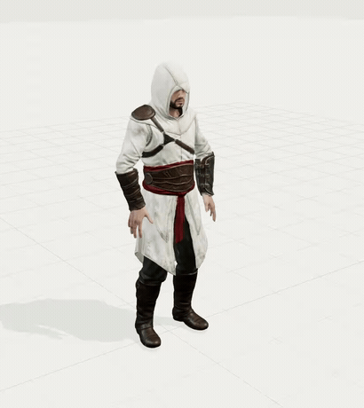

# 兜帽刺客蹲起示例

这段动画来自一次自然语言制作任务：“生成一个刺客信条的角色，并实现蹲起的动画”。Agent 选择白色尖兜帽、红腰带、皮革护具和金属护腕的外观，并设计了 5 秒蹲起循环。角色是通过 Meshy AI 新生成的风格化资产，不是游戏原版模型。

## 制作过程

| 阶段 | 工具与产物 |
| --- | --- |
| 设计 | GPT 6 确定外观、关键姿势、重心变化和动作节奏 |
| 角色生成 | Meshy 外观参考、Meshy 7 模型生成、Meshy 骨骼绑定 |
| 动画制作 | Blender 4.5.13 LTS，制作关节运动并逐帧烘焙 |
| 导出 | 保留可编辑 `.blend`；GLB 包含 PBR 材质、24 根骨骼及 `Assassin_Crouch_Stand` 动画 |
| 预览 | Three.js 0.180.0、Chrome 153，通过查看器的载入、播放、镜头和倍速控件检查 |

蹲起动作在 Blender 中制作，未使用提供方的走路或跑步片段。角色身高 1.8 m，最终导出为 65,255 个三角形。

| 时间 | 动作 |
| --- | --- |
| 0–0.45 秒 | 站立准备 |
| 0.45–2 秒 | 骨盆后移、屈膝下蹲，双臂前移参与平衡 |
| 2–2.85 秒 | 保持低姿势 |
| 2.85–4.65 秒 | 前倾发力，伸髋伸膝起身 |
| 4.65–5 秒 | 恢复站立，衔接下一次循环 |

制作中修正了鞋底蒙皮权重，减少下蹲时鞋底变形引起的移动；也恢复了绑定输出中丢失的原始 PBR 材质。初稿和修正版分别保留。

## 已检查的范围

2026-09-28 的本地制作检查覆盖 Blender 工程及重新导入的 GLB。以 30 fps 采样 151 个姿势，包含 0 秒和 5 秒两个端点：

- 检查了斜前方、正面和侧面的关键姿势，并录制 1× 原速预览。
- 采样 276 个实际蒙皮鞋底顶点，修正版 GLB 的最大位移约 0.0101 mm。
- 重新导入前后，髋、膝、踝关节最大位置误差约 0.0107 mm。
- 首尾网格顶点位置一致，动画导出时长为 5 秒。

README 的 GIF 由查看器实录转换，降低到 15 fps 以减小文件体积，保留 5 秒动作时长。它用于展示成片；技术检查针对原始工程和 GLB。

衣摆依靠骨骼蒙皮，深蹲时折叠偏硬；本次没有布料仿真、独立手指骨骼或面部表演。该示例尚未通过独立表现力评价，也没有作为已通过的迁移案例登记。

## 文件范围

仓库包含演示 GIF。原始角色、初稿、修正版、制作脚本、验证数据和视频保留在原制作环境的 `.artifacts/assassin-crouch/`，不随 Git 分发。使用 [README 中的提示词](../README.md#3-描述动作和交付要求) 可以发起同类任务，新的生成结果会有所不同。
